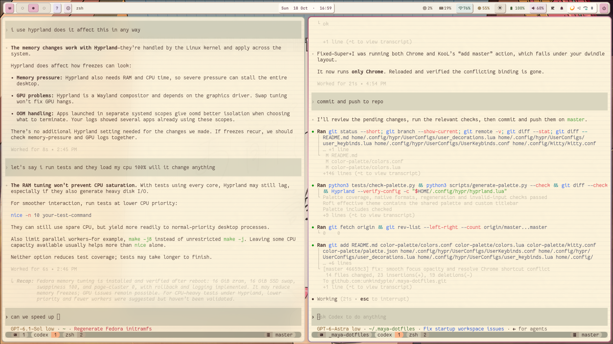

# Maya dotfiles

**Neovim config: [Maya Neovim](https://github.com/unkindypie/maya-nvim/)**

Paper colors, pastels and soft pink highlights for Waybar, Kitty, tmux and Zsh.
Works with KooL Fedora Hyprland; the main desktop components also work without KooL.



## Install

Works well on top of [Fedora Hyprland](https://github.com/LinuxBeginnings/Fedora-Hyprland), but should work on other wayland installation:

```sh
cd ~/.maya-dotfiles
python3 install.py
```

The installer backs up replaced files and asks whether to install Maya Neovim.
Use `--with-mvim` or `--without-mvim` to choose explicitly. Maya Neovim has its
own dependency installer, which may ask for sudo or additional choices.

Missing Oh My Zsh and tmux plugins download at the revisions in dependencies.json.
Existing installations and local changes are preserved. A fresh install needs
internet; use `--skip-dependencies` for an offline install with dependencies ready.

Install the following dependencies first. These are the versions installed on the
reference Fedora desktop on **2026-10-18**, not enforced minimum versions.

**Core tools and desktop:**

- Git **2.56.0**
- Python **3.14.8**
- Zsh **5.9**
- Kitty **0.47.1**
- tmux **3.7c**
- Waybar **0.15.0** (Fedora build `0.15.0^2.git1684389`)
- fzf **0.74.4**
- Hyprland **0.56.2** — the reference Wayland desktop for the included Lua config.
- Nerd Fonts — bundled Fantasque Sans Mono from Nerd Fonts **3.3.0** and
  JetBrains Mono from Nerd Fonts **3.4.0**; no separate font download needed.

**Launcher and bar controls:**

- Rofi **2.0.0**, with Wayland support (`rofi` on this Fedora setup;
  some distributions name the Wayland package `rofi-wayland`).
- brightnessctl **0.5.1**
- WirePlumber **0.5.18** (provides `wpctl`)
- pavucontrol **6.2**
- nm-connection-editor **1.36.0**
- playerctl **2.4.1**

**Screen locking:**

- hyprlock **0.9.6**
- hypridle **0.1.8**

**Optional integrations:**

- SwayNC / SwayNotificationCenter **0.12.6** — notification center.
- lsd **1.2.0** — styled directory listings.
- fastfetch **2.68.1** — terminal system information.
- hyprshot **1.3.0** and Swappy **1.5.1** — required for the screenshot and
  annotation shortcuts.

The installer’s Git-based dependencies are pinned separately by commit in
[`dependencies.json`](dependencies.json). Existing installations are preserved.

## Edit your configs

Installed configs are linked to `home/`, so edits stay in sync with this repo.
See the [configuration guide](docs/configuration.md) for file locations,
customization, shortcuts, and reload instructions.

## KooL integration and protection

Waybar optionally shows KooL's help, settings and blue-light filter buttons when
their scripts and applications exist. Otherwise they hide. The network button
opens NetworkManager's GUI. Original KooL Waybar files are archived in reference/.

`maya-waybar.service` runs the bar; `waybar.service` aliases it so KooL startup
and refresh use the same instance. The installer and link recovery also patch
KooL’s dropdown discovery to match only its dedicated terminal class, preventing
it from hiding another app during login. Original scripts are backed up; upstream
source trees are not stored here.

`maya-dotfiles.path` repairs replaced
Kitty, Waybar, Rofi, Wofi, SwayNC and Hyprland user-config symlinks. Vendor writes _through_ a symlink
also change the repo: inspect `git diff` after theme tools. Keep this repo in
place. Backups live in `~/.local/state/maya-dotfiles/backups/`.

```sh
# Disable the managed bar and link recovery:
systemctl --user disable --now maya-dotfiles.path maya-waybar.service
```

Without systemd, install with `--no-services` and start
`~/.local/bin/maya-waybar` from Hyprland. Automatic recovery requires systemd.
Disable other Waybar launchers if they create duplicate bars.

## Checks

```sh
python3 tests/check.py
python3 tests/check-dependencies.py
git diff --check
```

See ATTRIBUTION.md for asset sources and licenses.

## Shared colors

Edit [`color-palette/palette.json`](color-palette/palette.json) in the repo root.
The installed `~/.config/maya-theme/` files link to `color-palette/`. Different paper,
pink and app-specific shades have separate names; no colors are forced to match.
Exact duplicates and unreviewed near-duplicates are rejected. A conservative
Oklab distance check (<0.02) flags similar opaque shades. Two documented
exceptions preserve terminal white versus warm paper and lavender versus pink;
alpha variants remain separate. Run `python3 scripts/generate-palette.py --audit`
to review them. The palette has 59 colors, reduced from 80.
It supplies Waybar, Wofi, Rofi, SwayNC, Hyprlock, Hyprland and Kitty's personal Novel theme.

```sh
python3 scripts/generate-palette.py
```

This updates small native include files (and Wofi’s generated color header),
not whole config templates. Wofi needs an inline header because its CSS imports
resolve from the launch directory. Layouts
remain directly editable. The installer also regenerates these files. Reload
Waybar/Hyprland, restart Kitty or reload its config, and reopen launchers/the locker
to apply. `python3 scripts/generate-palette.py --check` checks for stale includes.
Edit the palette rather than generated files. Other Kitty themes, Wallust output,
and tmux/mvim's separate palettes are unchanged. Palette values do not recolor
the wallpaper or texture image itself.

## License

Original Maya code and configuration are licensed under
[GPL-3.0-or-later](LICENSE). Third-party files and assets retain their own licenses;
see [licensing details](docs/licensing.md) and [attributions](ATTRIBUTION.md).
